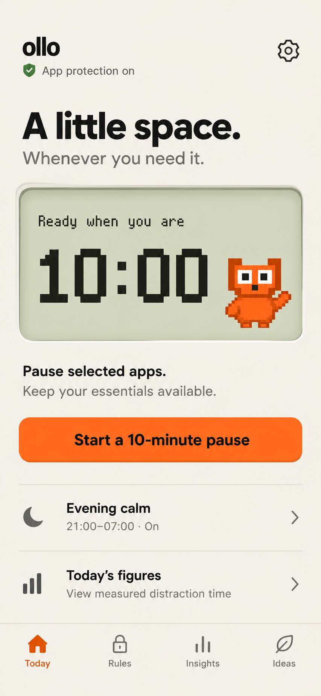
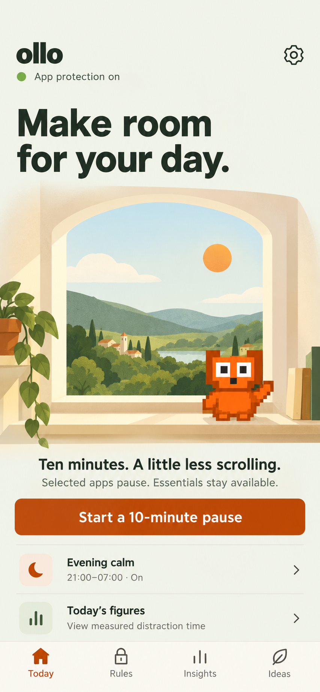
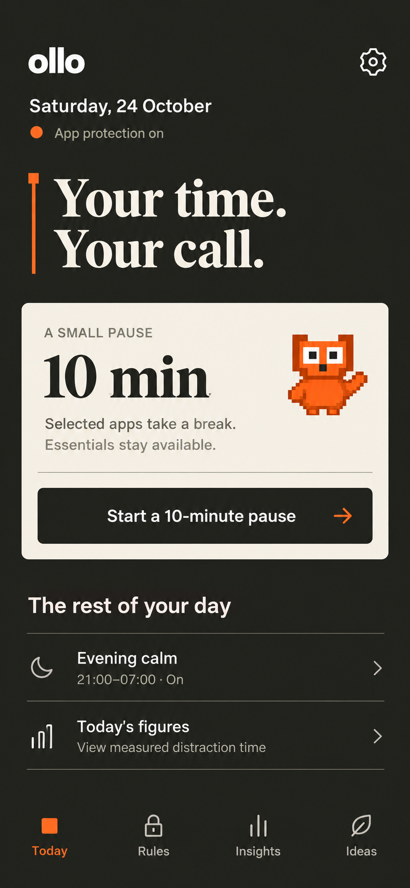

# Ollo: a small instrument for your attention

**Recommendation: Pocket Console.** Give Ollo a warm, tactile interface built around its orange pixel companion and a clear pixel timer. Put the useful pause action first, keep everyday controls familiar, and let detailed reporting live in Insights.

The opportunity is a recognizable experience at the moment someone chooses what to do next. Ollo already has the raw ingredients. The character, countdown, opening choice and finite learning exercise can share one visual language.

This is design research and visual exploration. The concepts are static generated images; the recommendation is my design judgment. No user study establishes which direction people prefer or whether a visual treatment improves outcomes.

## Three directions, one comparable task

All three show a configured, healthy Today screen before starting the same existing ten-minute pause. They share a clear action, selected-app scope, access to essentials, one routine and a route to measured figures. The evening schedule is illustrative fixture data.

| 1. Pocket Console | 2. Window Seat | 3. Margin Notes |
| --- | --- | --- |
|  |  |  |
| [Open full image](assets/design-directions/2026-10-24/pocket-console.png) | [Open full image](assets/design-directions/2026-10-24/window-seat.png) | [Open full image](assets/design-directions/2026-10-24/margin-notes.png) |

The numbers follow the order the generated images appeared in this chat. The concepts use English, consistent with the current product direction. Saturday, 24 October 2026 is the date anchor. "Ideas" is proposed shorter navigation copy for the existing Alternatives area.

## What I researched

- Read Ollo's current UI source, theme, pause screen, opening-plan model, existing research and mascot provenance. Source snapshot: 07a372e4181236413cf97dccbd738c49f1377115.
- Read the Ollo knowledge area's marketing context and recent USP/onboarding research. Existing founder preferences emphasize a simple interface and an orange pixel character with personality.
- Inspected 48 returned Mobbin screen images. Selected 14 useful references from nine apps: Opal, Jomo, Headspace, Oura, stoic., Duolingo, Forest, Things 3 and Breathwrk.
- Reviewed the three preview frames returned for an eight-screen Jomo unlock-method flow and five preview frames returned for a 17-screen Opal onboarding flow. This is sampled visual review, not a complete walkthrough.
- Checked primary research on pre-open choices and Android's current accessibility guidance.
- Generated three independent concepts with the built-in image tool, attaching Ollo's actual mascot, existing screenshots and relevant downloaded Mobbin references.

The Mobbin sample is mostly iOS. Its useful contributions are hierarchy, grouping and feedback; Android interaction patterns should remain familiar. Screens are captured references, not proof of the products' current runtime behavior.

Searches for Endel and Finch returned no screens. A one sec query returned the unrelated banking app One; those images were excluded. Broad searches also returned irrelevant entertainment/fitness screens. The search manifest retains these results so the research is auditable without presenting false matches as evidence.

[Reference atlas with the 14 saved images](DESIGN-REFERENCE-ATLAS-2026-10-24.md) / [Full search and source manifest](assets/design-directions/2026-10-24/source-manifest.json)

## What Ollo already has, and where the design can help

### Its character and timer can become a system

The orange square eyes, blocky silhouette and bitmap countdown are recognizable ingredients. In the current Today capture, the character sits beside a general heading while the rest of the page uses conventional summary/report structure. The pause screen already uses both the timer and a larger character.

The next step is to give those ingredients a consistent role: the character marks a moment of choice; the display communicates a bounded amount of time. They should feel related across Today, a running pause and an opening prompt.

### The helpful action arrives late

In the inspected Today source, the ten-minute pause action follows usage totals, measurement notes, the hourly chart and morning/evening rows. In the supplied home captures, the pause action is beyond the first viewport.

Moving it before reporting makes the app's immediate purpose easier to discover. Keep a compact route to today's figures and preserve detailed measurements in Insights. This is a hierarchy proposal; users who primarily check usage should be included in validation.

### Honesty is an asset that needs clearer hierarchy

Ollo distinguishes missing data, partial measurements, Android totals, selected-app usage and permission state. That care should survive a visual refresh.

Use a concise source/coverage label beside a number, then offer its explanation nearby. Permission problems and the limits of an active block stay prominent. Essential disclosure must remain readable before a relevant system access request.

### Repeated opening should feel lighter

The inspected remembered-purpose capture is a long form with separate purpose choices, duration choices, explanation, memory controls and subsequent actions. The current source also supports custom purposes and finish conditions, beyond that dated capture.

For a returning user, explore a compact summary of the saved choice with a clear Change action. Editing can expand the complete form. Remembering a choice must remain distinct from confirming this opening, and all existing optional paths and rule precedence must remain understandable.

## The most useful Mobbin lessons

| Reference | What is visible | What Ollo can take from it |
| --- | --- | --- |
| [Opal timer](https://mobbin.com/screens/f4a87447-8dde-4111-ad25-2f264eff24ab) | A very large digital timer, a start action and an explicit blocking-state label. | Make duration and protected scope understandable together. Ollo can use its own pixel display and a much quieter surrounding surface. |
| [Opal opening intervention](https://mobbin.com/screens/b7a85dff-8e86-4211-9dec-73f5bf2ac492) | A focused breathing state, a visible wait and a separate dismissal action. | Keep a repeated interruption narrow and easy to understand. A clear way to leave deserves visual weight. |
| [Jomo grouped rules](https://mobbin.com/screens/ff9de1b3-3548-467b-bc94-85a305a62ba0) | Rules are grouped under meaningful headings, with readable state and progress. | Organize Rules by the person's routine and current state. A collection of settings can still scan as a coherent plan. |
| [Jomo save feedback](https://mobbin.com/screens/ef76690d-ddc7-431c-9c19-4b63190ca03d) | A clear confirmation appears above the updated rule list. | Make saving visible without adding a persistent status card to every screen. |
| [Headspace session player](https://mobbin.com/screens/d5b9ff12-33e0-4ec4-ae64-82c70e68ba0d) | One strong central control and large warm color fields. | Give a pause a recognizable visual atmosphere. Ollo does not need a recommendation feed or course catalog around it. |
| [Headspace Today sequence](https://mobbin.com/screens/c7fcbf0d-0846-43a4-a0b5-89e681b6f4ce) | A small day sequence with short descriptions and distinct illustration. | Use a little contextual character/art around an actual routine. Keep the amount of content bounded. |
| [Forest timer](https://mobbin.com/screens/fb6274de-c7ca-4981-b33a-d024d3945180) | A tangible tree metaphor dominates the focus screen alongside duration. | A single meaningful visual object can be more memorable than many metrics. Ollo's character can serve this role without a reward economy. |
| [Forest history](https://mobbin.com/screens/faa0e4b3-3710-4c77-92ad-b9a0db119ac8) | The expressive world and detailed time-distribution chart have separate areas. | Separate the immediate pause experience from later analysis. |
| [Things 3 Today](https://mobbin.com/screens/feadd020-045b-477e-b54f-d4c405995a58) | Plain rows, whitespace and an evening heading communicate structure with little framing. | Let useful lists stay lists. Morning/evening routines need less decorative containment than a hero timer. |
| [stoic. entries/search](https://mobbin.com/screens/261d032c-d068-472f-b1ec-cd098496f11e) | Restrained typography, fine separators and concise secondary information. | Build calm through typesetting and grouping, especially on secondary screens. |
| [stoic. journal timeline](https://mobbin.com/screens/29493be0-df7a-4d60-b094-81761d272482) | Different entry types remain scannable through a consistent title, label and time rhythm. | Establish a stable visual grammar for different rule types, rather than a different card treatment for each. |
| [Duolingo exercise](https://mobbin.com/screens/fa963b87-61a6-40be-8192-3060fe947088) | One exercise, explicit progress and a distinct action area. | Keep the optional three-question learning gate finite, with clear selected, correct and retry states. |
| [Oura missing-readiness state](https://mobbin.com/screens/f2b123f2-bf28-4fc4-83b7-b4d4a7f91ab1) | An explicit unavailable state appears instead of a fabricated readiness number. | A missing measurement can be a designed state. Ollo should continue to distinguish unavailable from zero. |
| [Breathwrk exercise](https://mobbin.com/screens/22a34ba5-9da8-41c2-800c-d1376abc076d) | Current phase and the central control dominate, with small secondary controls. | During a pause, answer what is happening now before showing administrative detail. This is hierarchy inspiration, not a proposal to add breathing exercises. |

Additional flow references: [Jomo unlock-method setup](https://mobbin.com/flows/cee5c462-2dcd-4d5a-9a98-20ba51ae67af) demonstrates a concise session summary in the sampled frames. [Opal onboarding](https://mobbin.com/flows/91394aa7-8b77-461f-b95a-ad3f177e98f3) demonstrates strong one-question hierarchy in its previews. Its length is not evidence that Ollo should add onboarding steps.

## Why Pocket Console is the strongest direction

### The signature

A warm, putty-colored display containing Ollo's pixel countdown and orange companion. A bright, clear pause action sits immediately below. Plain lists surround this focal point.

It gives Ollo a repeatable visual component rather than depending on a different illustration for every surface. The pixel language already exists in the app and can remain recognizable in a small capture.

### The feeling

Friendly, capable, slightly tactile. A useful little object someone operates briefly. The character supplies warmth; the surrounding interface supplies clarity.

The console metaphor should stay restrained. The generated display's glow/bevel is a direction to simplify in refinement. Avoid turning the UI into a detailed drawing of physical hardware.

### How it travels through the product

- Today: a ready-to-start duration and one pause action.
- Running pause: remaining time in the same display, followed by the existing essentials and urgent-access routes.
- Opening prompt: a compact intention/time summary with clear leave, edit and permitted-open actions.
- Optional exercise: three small square progress markers and readable choices. Pixel styling stays in illustration and progress accents.
- Finish: a short acknowledgment, then an obvious way back to the day.
- Rules and Insights: normal readable controls and grouped rows; the character appears sparingly.

### The trade-off

The initial raster can make "10:00" look like an already-running timer. "Ready when you are" helps, but first-use comprehension needs testing. A "10 min" preview may prove clearer; keep the actual live countdown for the active state.

A permanent large slogan is also optional. For frequent use, a shorter functional heading may earn its space better.

## Window Seat: strongest for warmth and atmosphere

The visual signature is a quiet window, a little daylight and the pixel character on its sill. Soft green and cream move the app toward an approachable everyday companion.

This direction offers the most room for original illustration. It could make onboarding and the pause screen feel inviting while keeping selected-app scope and essentials explicit.

Its cost is a more substantial art system. The generated landscape is richer and taller than the compact frame in the brief. On smaller screens, the window should shrink before the action or text does. Keep it a static, bounded scene; a growing world or daily collection would change the product's incentives.

The material/illustration treatment needs careful consistency with the intentionally blocky character. This is the strongest alternative if emotional warmth matters more than a tool-like identity.

## Margin Notes: strongest for editorial restraint

The signature is warm ink, ivory, a fine orange margin rule and a small printed-looking pause slip. A readable display serif gives the screen a quieter, more adult typographic identity.

It uses the least environmental illustration and could suit someone who finds an expressive scene too decorative. The character acts as a small recognition cue.

The trade-off is distance from the existing light, orange-first identity. A dark-first concept also creates a broader theme and contrast task across editors, dialogs, charts and Android system bars. A serif should stay in a few display moments; functional copy and selections remain simple sans-serif.

The generated orange dot above "App protection on" could be read as a warning. Use explicit text and a consistent semantic status treatment in refinement.

## Comparison

These are qualitative design judgments, not user preference scores.

| Consideration | Pocket Console | Window Seat | Margin Notes |
| --- | --- | --- | --- |
| Recognizable signature | Pixel display + companion | Illustrated window + companion | Editorial margin + pause slip |
| Main appeal | A clear, friendly tool | Warmth and breathing room | Quiet typography and restraint |
| Fit with existing Ollo assets | Strongest | Strong character fit; new scene family | Character retained; broader style departure |
| Artwork effort | Low to medium | Highest | Low |
| Visual-system change | Moderate | Moderate | Broad if dark-first |
| Main comprehension risk | Preview mistaken for active timer | Illustration competes with action | Editorial style obscures utility |
| My recommendation | Lead direction | Strong second route | A deliberate taste alternative |

## A concrete visual brief for the lead direction

### Palette

Use a small role-based palette. Keep the existing Forest and Plum personalization choices coherent if this direction is implemented; orange remains the character's identity.

| Role | Proposed color | Use |
| --- | --- | --- |
| Main surface | #F4F1E8 | Warm chalk background |
| Main ink | #25231F | Body, headings, bright-orange button text |
| Secondary ink | #68655F | Helpful supporting copy |
| Character / expressive accent | #FF6B1A | Mascot, selected markers, main button with dark text |
| Accessible orange action | #B94000 | Existing darker action color where white text is used |
| Display surface | #E3E8D3 | One timer/display treatment |
| Dividers | #DEDCD3 | Quiet grouping, not card outlines |

Calculated solid-color contrast: charcoal on bright orange is 5.50:1; white on dark orange is 5.53:1; secondary ink on warm chalk is 5.14:1; main ink on the display surface is 12.51:1. White on bright orange is only 2.85:1, so keep dark text on that button.

These calculations check proposed tokens, not the generated images' textured pixels. Android recommends at least 4.5:1 for normal small text and at least 3:1 for larger text. [Android text visibility guidance](https://developer.android.com/guide/topics/ui/accessibility/apps)

### Type, spacing and shape

- Keep functional typography close to Ollo's readable native sans. Start with 16sp body, 14sp supporting copy and roughly 28-32sp screen headings.
- Reserve bitmap digits for bounded time displays. Avoid pixel paragraphs and decorative micro-labels.
- Use 24dp outer spacing at ordinary phone widths, clear groups with 24-32dp separation, and smaller 8-16dp relationships inside a group.
- Use a 56dp primary action target and at least 48dp interactive targets throughout. Treat entire settings/selection rows as one clear target. [Compose accessibility defaults](https://developer.android.com/develop/ui/compose/accessibility/api-defaults)
- A display can use a 16dp radius and a very subtle inset edge. Buttons can keep the existing 12dp family. Ordinary rows use spacing and dividers.
- Reflow content at enlarged text sizes. The display and character can become smaller; essential actions and explanatory text must keep their readable size.

### Motion and character

Use brief acknowledgment at a state change: a small character pose change after a pause starts, a calm transition into the live countdown, and a concise answer acknowledgment in exercises. These are proposed refinements.

Keep idle screens still. Avoid continuous bouncing, attention-seeking reactions, guilt expressions, fireworks and rewards for opening Ollo. A reduced-motion experience should carry the same information.

### Copy

Keep copy concrete and voluntary:

| Moment | Candidate copy |
| --- | --- |
| Ready | Start a 10-minute pause |
| Scope | Selected apps pause. Essentials stay available. |
| Active | Distraction paused |
| Opening | What brings you here? |
| Saved choice | Your saved plan / Change |
| Check-in | Did you finish what you came for? |
| Finished | Your pause is over. Other active rules still apply. |
| Service unavailable | App protection is off. Restore access. |
| Measurement unavailable | Usage figures are unavailable. |

These are candidate labels, not a decision to replace all existing copy.

## State rules the visual concept must survive

| Actual situation | What the screen must communicate |
| --- | --- |
| Configured, service available, no pause active | A ready state and an explicit action. A preview is not an active countdown. |
| No distraction apps selected | A clear setup route; avoid implying selected apps are already protected. |
| Accessibility disconnected | Protection is off, with a clear repair route. A running timer alone does not mean blocking works. |
| Usage access missing but blocking available | Distinguish unavailable figures from protection state. |
| Multiple restrictions active | Preserve the explanation of relevant restrictions and deadlines. One countdown must not imply that every rule ends with it. |
| Selected app opened during a fixed restriction | Explain the reason, remaining time and available essentials/urgent access. An intention or exercise cannot bypass the rule. |
| Opening is permitted | A compact optional intention flow with clear leave, edit and appropriate continue choices. |
| Learning gate enabled | Three correct answers and the existing explicit final-open action; understandable retry and exit paths. |
| Remembered plan present | Preselected defaults still require confirmation; change and forget remain available. |
| Check-in due | Finish, continue and dismiss remain understandable. The cue cannot know whether a real-world task is complete. |
| Missing or partial usage | Keep missing, partial and zero distinct. Explain the source without a misleading success graphic. |
| Enlarged text / TalkBack | Logical reading order, normal text semantics, reachable actions, no icon-only status. |

The study of one sec supports examining the quality of the leave choice. It reports that the option to dismiss consumption had the strongest effect in a preregistered online experiment with 500 participants; waiting also had an effect. That study does not compare Ollo's visual directions. Its field results concern a different app and population, and one author created one sec. My design inference is to give the leave choice clear, useful prominence rather than adding more simultaneous messages. [Gruning, Riedel and Lorenz-Spreen, PNAS, 2023](https://pmc.ncbi.nlm.nih.gov/articles/PMC9974409/)

## What to validate after choosing a direction

A small formative walkthrough should answer these questions before extending a style throughout the app:

1. Can someone find and explain the ten-minute pause action quickly?
2. Can they distinguish a ready preview from a running pause?
3. Can they explain which apps pause and how essentials remain available?
4. Can they leave an opening prompt and understand when an existing fixed rule still applies?
5. Can they change or forget a saved plan without mistaking it for automatic access?
6. Does the experience remain readable at 200% text size and at narrow widths?
7. Does the character feel friendly without making the person feel monitored or judged?

Observe task completion and misunderstandings. Ask whether someone would choose the experience again. Visual polish alone cannot establish helpfulness or retention.

## Deliverables and verification

- Three independent full-screen PNG concepts, each 853 x 1844 pixels, composed for an approximately 390 x 844 logical viewport.
- Fourteen original high-resolution Mobbin reference downloads, retained as WebP with canonical source links.
- The complete search-result manifest, including sampled-flow metadata and excluded search matches.
- The three exact generation prompts: [Pocket Console](assets/design-directions/2026-10-24/pocket-console-prompt.txt), [Window Seat](assets/design-directions/2026-10-24/window-seat-prompt.txt), [Margin Notes](assets/design-directions/2026-10-24/margin-notes-prompt.txt).
- Generated files copied into the Ollo knowledge area and checked against their original hashes.
- Proposed palette contrast calculated. Images inspected for hierarchy, readable copy, character continuity and obvious cropping.
- Native layout, interactive behavior, TalkBack and enlarged-text acceptance remain untested for these static concepts.
- Ollo app source, configuration, dependencies and Git history were left unchanged.

**Decision to make:** choose a visual direction. My pick is Pocket Console, refined to make the ready state unmistakable and the display less glossy.

