# Ollo design reference atlas

Fourteen screen references selected after inspecting 48 Mobbin search results on 24 October 2026. These are visual references from captured iOS interfaces; app versions and capture dates are not established here. The observations below concern what is visible, not tested behavior.

[Read the recommendation and three Ollo concepts](DESIGN-DIRECTION-RESEARCH-2026-10-24.md).

The original high-resolution images are downloaded locally. Canonical Mobbin links appear beside every reference. Research images are separate from Ollo's shipped assets.

| [Opal: Duration and blocking scope](https://mobbin.com/screens/f4a87447-8dde-4111-ad25-2f264eff24ab) | [Opal: A narrow interruption](https://mobbin.com/screens/b7a85dff-8e86-4211-9dec-73f5bf2ac492) |
| --- | --- |
| 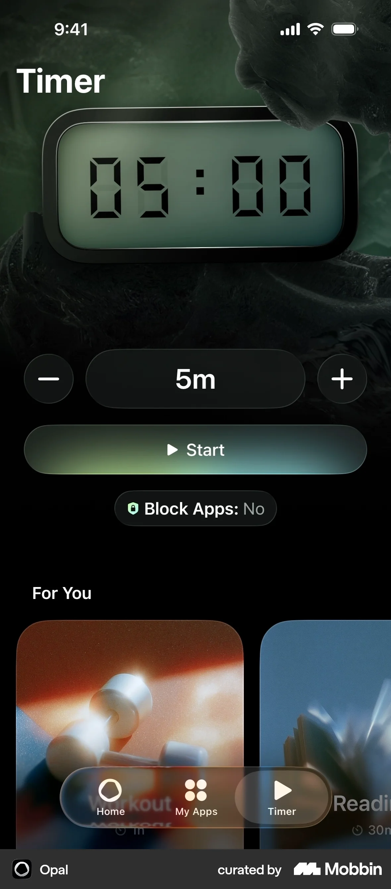 | 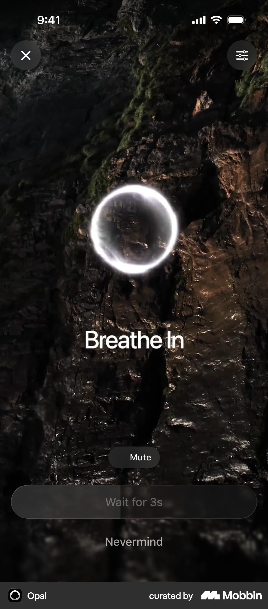 |
| A large timer dominates; blocking state is explicitly labeled. Keep the hierarchy, develop Ollo's own display and quiet surrounding UI. | One current phase, a wait state and a visible dismissal. Preserve a useful leave choice. |

| [Jomo: Rules as a readable plan](https://mobbin.com/screens/ff9de1b3-3548-467b-bc94-85a305a62ba0) | [Jomo: Visible save feedback](https://mobbin.com/screens/ef76690d-ddc7-431c-9c19-4b63190ca03d) |
| --- | --- |
| 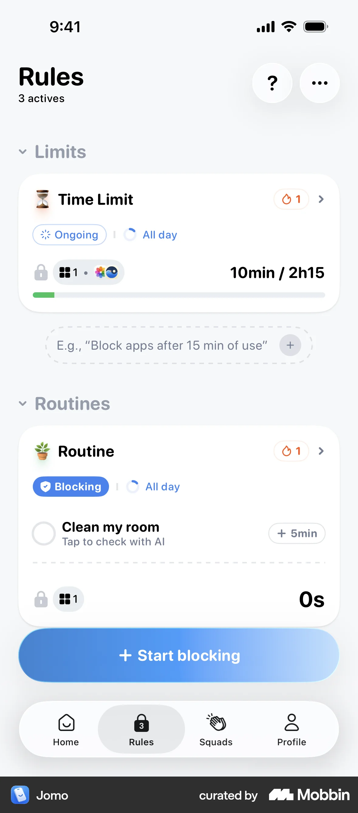 | 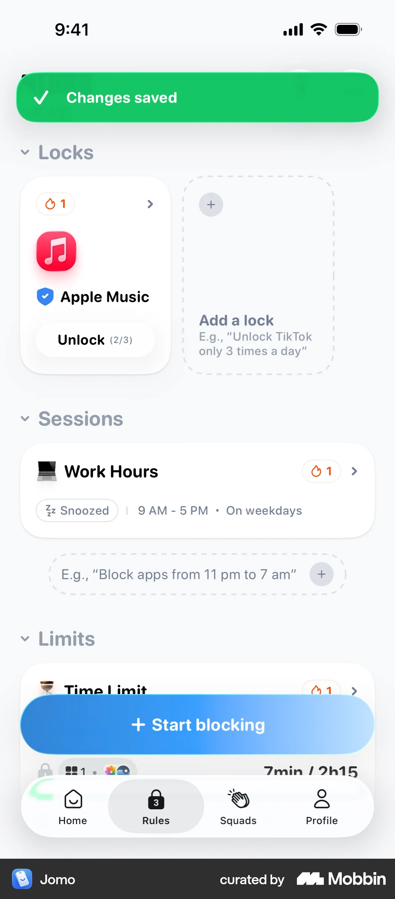 |
| Meaningful groups and explicit state help complex configuration scan. | A concise confirmation makes the changed state apparent. |

| [Headspace: Atmosphere around one action](https://mobbin.com/screens/d5b9ff12-33e0-4ec4-ae64-82c70e68ba0d) | [Headspace: A bounded daily sequence](https://mobbin.com/screens/c7fcbf0d-0846-43a4-a0b5-89e681b6f4ce) |
| --- | --- |
| 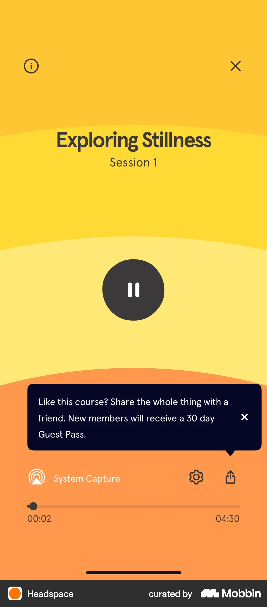 | 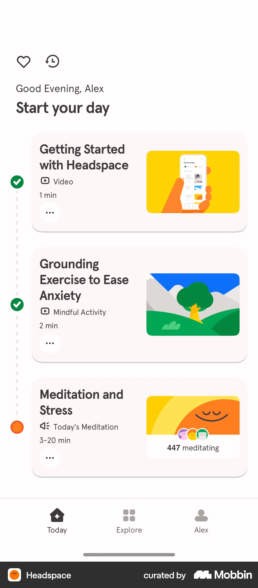 |
| Large warm color areas and a clear central control give the session a recognizable mood. | Short descriptions and varied illustration differentiate a small number of activities. |

| [Forest: A tangible focus object](https://mobbin.com/screens/fb6274de-c7ca-4981-b33a-d024d3945180) | [Forest: Separate expression from analysis](https://mobbin.com/screens/faa0e4b3-3710-4c77-92ad-b9a0db119ac8) |
| --- | --- |
|  | 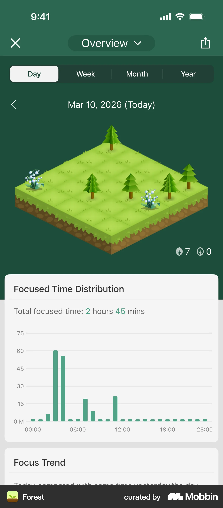 |
| One visual metaphor can carry identity and make a timer feel less abstract. | The world metaphor and the detailed chart occupy different areas. |

| [Things 3: Grouping without heavy cards](https://mobbin.com/screens/feadd020-045b-477e-b54f-d4c405995a58) | [stoic.: Editorial restraint](https://mobbin.com/screens/261d032c-d068-472f-b1ec-cd098496f11e) |
| --- | --- |
|  | 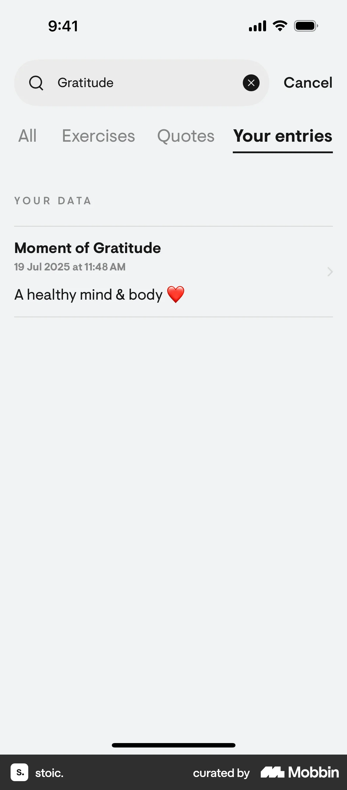 |
| Whitespace, a simple evening heading and ordinary rows carry the information hierarchy. | Plain typography, a fine separator and useful secondary copy give a sparse result structure. |

| [stoic.: A stable entry grammar](https://mobbin.com/screens/29493be0-df7a-4d60-b094-81761d272482) | [Duolingo: A finite exercise](https://mobbin.com/screens/fa963b87-61a6-40be-8192-3060fe947088) |
| --- | --- |
| 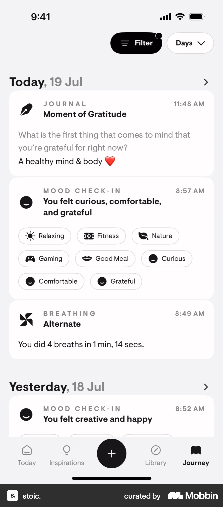 | 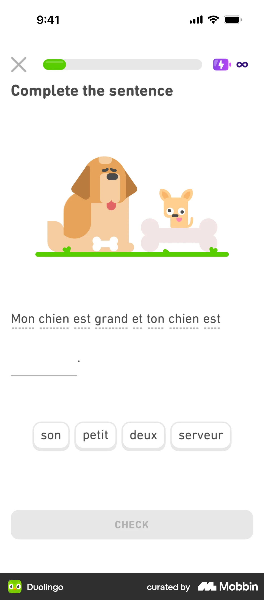 |
| Labels, titles and time maintain a consistent rhythm across different entry types. | One question and explicit progress make the next task clear. XP and attendance incentives are separate choices. |

| [Oura: An honest unavailable state](https://mobbin.com/screens/f2b123f2-bf28-4fc4-83b7-b4d4a7f91ab1) | [Breathwrk: Current-state clarity](https://mobbin.com/screens/22a34ba5-9da8-41c2-800c-d1376abc076d) |
| --- | --- |
| 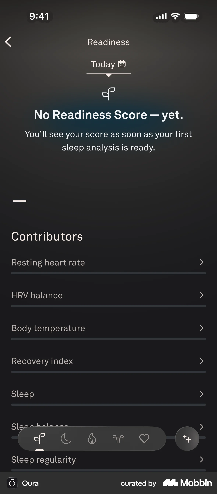 | 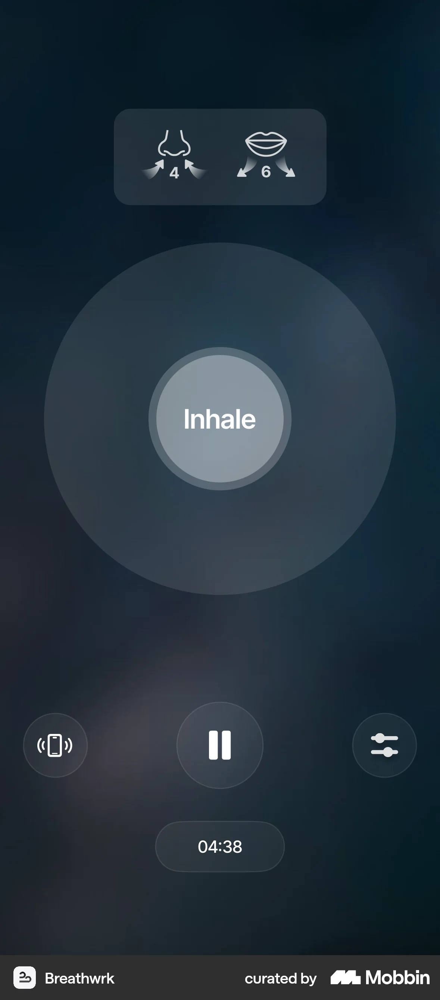 |
| No readiness number is fabricated while the underlying data is missing. | The active phase and main control have priority over secondary controls. |

## Flow samples

- [Jomo: Setting up an unlock method](https://mobbin.com/flows/cee5c462-2dcd-4d5a-9a98-20ba51ae67af): eight-screen flow, three preview frames inspected. The returned flow concerns unlock configuration, despite a broader session-start query.
- [Opal: Onboarding](https://mobbin.com/flows/91394aa7-8b77-461f-b95a-ad3f177e98f3): 17-screen flow, five preview frames inspected. Clear question hierarchy is a design reference; onboarding length is not a retention recommendation.

The [source manifest](assets/design-directions/2026-10-24/source-manifest.json) retains screen IDs, original image URLs, canonical Mobbin links, query wording and flow metadata. Original image URLs can expire; the saved images remain usable locally.

